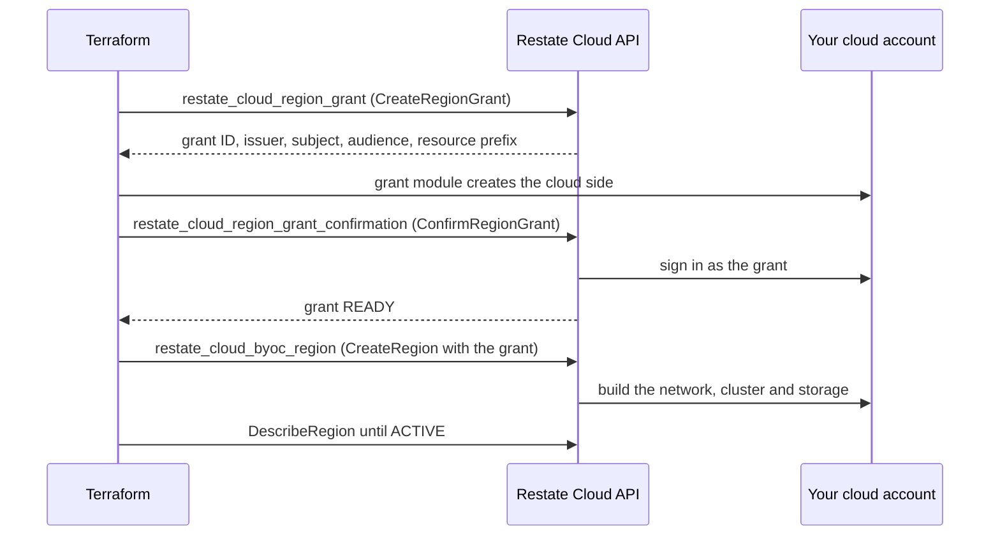

# Managed BYOC regions with a region grant

With Managed BYOC, Restate builds and operates a region in your own AWS account, GCP project or Azure
subscription. A **region grant** gives Restate access to one such cloud account, and every region
built with it runs there. You set up a grant once for each cloud account. After that, a region is one
more `restate_cloud_byoc_region` resource, with no change in your cloud.

BYOC must be enabled for your account or organization first. Restate enables it on request.

## One configuration

The grant modules in this repository, one for each cloud, create the cloud side of the grant and
use this provider for the Restate side. One module block and one apply create the grant, confirm
it and build the regions you list. The module uses your `provider "restate"` configuration, and
the cloud provider's configuration for the cloud account.

```hcl
provider "restate" {} # RESTATE_CLOUD_ACCOUNT_ID and RESTATE_CLOUD_MANAGEMENT_API_KEY

module "restate_byoc" {
  source = "github.com/restatedev/terraform-restate-cloud//modules/byoc/aws"

  region_grant = {
    owner = "ACCOUNT"
    regions = {
      prod-eu = { cloud_region = "eu-central-1" }
    }
  }
  oidc_provider_arn = var.oidc_provider_arn
}
```

The source for Google Cloud ends in `modules/byoc/gcp`, and the one for Azure in
`modules/byoc/azure`. Each module's README lists its inputs and every permission the grant holds.
Use the resources below directly when the cloud side is managed some other way, for example by
another team.

## The three resources

| Resource | What it does |
| --- | --- |
| `restate_cloud_region_grant` | Creates the grant at Restate, which answers the values that the cloud side of the grant is built from. |
| `restate_cloud_region_grant_confirmation` | Hands the cloud side to Restate. Restate signs in through it, checks that it acts in the grant's cloud account, and marks the grant `READY`. |
| `restate_cloud_byoc_region` | Builds a region with a `READY` grant, and waits until it is `ACTIVE`. |

The cloud side of the grant sits between the first two. The grant module in
[`modules/byoc`](https://github.com/restatedev/terraform-restate-cloud/tree/main/modules/byoc) creates it,
with one directory for each cloud. It takes four values from `restate_cloud_region_grant`, and its
`grant` output goes unchanged to `restate_cloud_region_grant_confirmation`.

| Grant attribute | What the cloud side does with it |
| --- | --- |
| `restate_issuer` | Trusts Restate's OIDC issuer. |
| `grant_subject` | Accepts only a token whose subject is this grant, `grant:<grant ID>`. |
| `token_audience` | Accepts only a token for this audience. |
| `resource_prefix` | Limits the grant's rights to resources whose names start with this prefix, which every region of the grant uses. |

No long-lived secret is involved. Restate signs in with a short-lived token from its issuer, and your
cloud checks the subject on every sign-in.

## Who owns a grant

| `owner` | Who manages the grant and builds regions with it | Provider credential |
| --- | --- | --- |
| `ACCOUNT` (default) | The provider's account. | The account's `rst:role::ManagementApiAccess` key. |
| `ORGANIZATION` | The account's organization, for regions in any of its accounts. | An organization administrator's token, or an organization API key with role `rst:role::OrganizationRegionGrantAccess`. Set `account_id` to any account of the organization. |

An organization API key with role `rst:role::OrganizationRegionGrantAccess` reaches the
organization's grants and the regions built with them, and nothing else. A configuration that also
manages environments needs a second provider configuration, with an alias and an account key.

Restate confirms only one grant for each cloud account, whoever owns it.

## Order of operations



Terraform takes this order from the references between the resources. Give `restate_cloud_byoc_region`
the confirmation's `grant_id` rather than the grant's `id`. The region then waits for the
confirmation, and a destroy deletes the region before the grant.

A new cloud grant can take minutes to work in every part of the cloud. The confirmation therefore
waits until the grant is `READY`, until its create timeout of five minutes by default. It tries
again when the cloud refuses Restate's sign-in, and where Restate keeps signing in on its own after
it accepts the output, it waits for that. If the grant is still not `READY`, the apply reports the
cloud's last message, the grant stays `PENDING`, and the next apply confirms it.

A grant that is not confirmed within seven days expires. A refresh that finds a grant expired or
deleted removes it from the state, so the next apply creates a new grant and updates the cloud side
for it.

## Destroying

| Resource | What destroy does |
| --- | --- |
| `restate_cloud_byoc_region` | Deletes the region and waits until Restate has removed what it built. Restate refuses while the region has environments. `deletion_protection`, true by default, refuses the destroy before it reaches Restate, so set it to false and apply first. |
| `restate_cloud_region_grant_confirmation` | Deletes the grant at Restate. Restate refuses while any region uses the grant. |
| `restate_cloud_region_grant` | Deletes the grant if the confirmation has not already done so. |

Terraform destroys the confirmation before the grant module, because the module's output is one of
its arguments. Restate therefore stops using the cloud side before Terraform removes it. When Restate
refuses because a region still uses the grant, the destroy stops at the confirmation, and the cloud
side stays in place. This needs the confirmation in the state: a confirmation whose create failed is
not there, and a destroy then removes the cloud side before it tries to delete the grant. That includes regions that other configurations built with an organization's
grant, which this configuration does not know about.

## Changing a grant

Restate has no update operation for a grant, so a change to `owner`, `cloud`, `cloud_account_id` or
`display_name` replaces it, and the plan warns when regions use it. A region keeps the grant it was
built with for its whole life, so Terraform deletes the regions this configuration builds with the
grant, and builds them again with the new one. `deletion_protection`, which is true by default,
stops that before anything is deleted. Restate refuses to delete the grant while a region of another
configuration still uses it.

A change to the module's `grant` output confirms the grant again in place. Restate accepts the output it
confirmed and refuses any other, so a different cloud side means a new grant.
