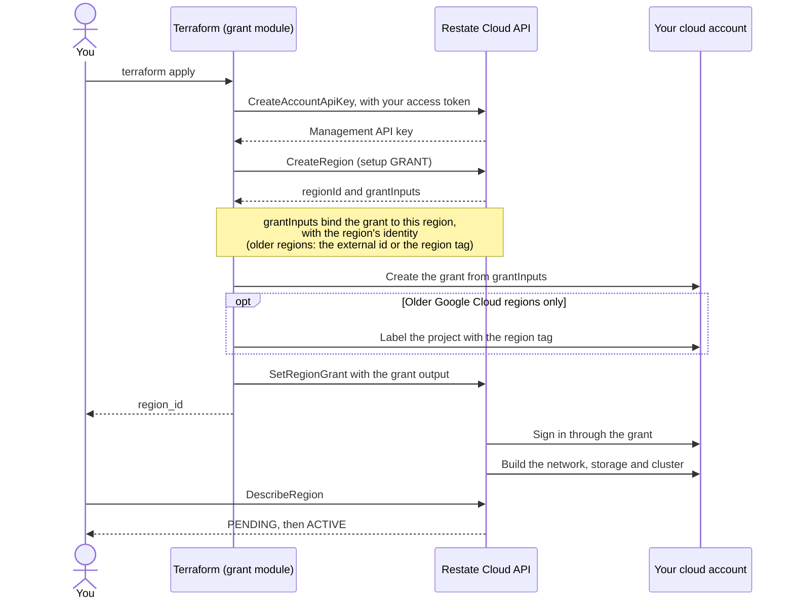

# Restate Cloud Managed BYOC: Setup guide

With **Managed BYOC** (Bring Your Own Cloud), Restate Cloud runs in your own AWS account, Google Cloud project or Azure
subscription. Your environments and their data stay with you, while Restate builds, upgrades and repairs the
infrastructure underneath them.

Each Managed BYOC region is a Kubernetes cluster with its own network and the storage for your environments' snapshots.
Restate operates it from outside your account, using access you grant with a small Terraform module. Once the region is
active, you create environments in it just as you would in a Restate-hosted region.

Managed BYOC is in preview. Your cloud provider charges your account for the region's resources from the moment Restate
starts building them.

## Key terms

| Term            | Meaning                                                                                                                                                                                                   |
| --------------- | --------------------------------------------------------------------------------------------------------------------------------------------------------------------------------------------------------- |
| Region          | One Managed BYOC deployment in one cloud location of your account. Restate gives it an id such as `rgn_x5z2y4qjmt`.                                                                                       |
| Grant           | The identity and permissions you create in your account so that Restate can build the region.                                                                                                             |
| Region identity | The identity Restate gives each new region. It is a short-lived token from Restate's OIDC issuer, and its subject `region:<region-id>` names the region. Your grant trusts this subject and no other one. |
| Region tag      | A value Restate chose for regions created before they had their own identity. On Google Cloud and Azure, it goes on your project or resource group to bind the grant to it.                               |

## Before you start

| You need                      | Why                                                                                                                                                                                                                                                                                                   |
| ----------------------------- | ----------------------------------------------------------------------------------------------------------------------------------------------------------------------------------------------------------------------------------------------------------------------------------------------------- |
| BYOC enabled for your account | Restate enables it on request for accounts with account billing.                                                                                                                                                                                                                                      |
| A dedicated cloud account     | The grant reaches every resource the region creates, so use an AWS account, Google Cloud project or Azure subscription that holds nothing else.                                                                                                                                                       |
| Rights to grant access        | On AWS you need to create IAM roles and policies. On Google Cloud you need to enable APIs, create service accounts and workload identity pools, and change the project's IAM policy and labels. On Azure you need to create role assignments in the subscription and app registrations in the tenant. |
| Terraform 1.10 or later       | The grant is a Terraform module in this repository, with one directory for each cloud. OpenTofu 1.11 or later works as well.                                                                                                                                                                          |
| Capacity in the account       | The region runs in three availability zones, so you need quota there for the machine types you choose.                                                                                                                                                                                                |
| Six Elastic IPs (AWS only)    | The region uses one NAT gateway and one entry address in each zone. AWS allows five per region by default, so ask AWS to raise quota `L-0263D0A3` to at least six. The module warns during `plan` when the quota is lower.                                                                            |

## How the access works

The grant gives Restate Cloud a narrow identity in your account. No long-lived secret is involved: nothing is shared
with Restate, and there is nothing to rotate. Every call Restate makes shows up in your cloud's audit log.

Restate decides how a region signs in when you create the region, and the region keeps that choice for its whole life.
Every new region gets its own **region identity**. Your cloud trusts it through OpenID Connect (OIDC) federation: it
accepts a short-lived token that Restate's issuer signs, but only when the token's subject names your region. Your
cloud checks this itself, on every sign-in, and the grant names only the issuer and the subject, so Restate can rotate
its keys without any change on your side.

| Cloud        | What the grant creates                                                                                                                                                                 | What binds it to your region                                                               |
| ------------ | -------------------------------------------------------------------------------------------------------------------------------------------------------------------------------------- | ------------------------------------------------------------------------------------------ |
| AWS          | An IAM role that only reaches resources whose names start with your region's name, a permissions boundary that every role the region creates must carry, and an OIDC provider.         | The role's trust policy accepts only a token whose subject is your region's identity.      |
| Google Cloud | A service account, a workload identity pool that trusts Restate's issuer, and the service account's roles on the project. Its storage rights only reach the region's snapshot buckets. | The pool accepts only your region's subject, and only that subject may act as the account. |
| Azure        | The region's resource group, and an app registration with Contributor on the subscription that trusts Restate's issuer through one federated credential.                               | The federated credential accepts only your region's subject.                               |

Regions created before regions had their own identity keep the access they were built with, and the module keeps their
grants unchanged. On Google Cloud and Azure, those grants trust Restate's composition cluster for a fixed list of
Restate's identities, and on AWS the grant's role trusts IAM roles in Restate's AWS account by ARN. Because every
customer's grant trusts the same Restate identities, each such grant is also bound to your region by a value that
Restate chose when you created the region.

| Cloud        | What binds an older grant to your region                                                                                       |
| ------------ | ------------------------------------------------------------------------------------------------------------------------------ |
| AWS          | The role's trust policy requires your region's **external id**.                                                                |
| Google Cloud | Your project carries the label `restate-cloud-region-<region tag>` set to your region's **region tag**, which the module adds. |
| Azure        | The resource group carries the tag `restate-cloud-region` set to your region's **region tag**, which the module adds.          |

On AWS, the permissions boundary keeps the roles the region creates within the rights of the grant. On Google Cloud, the
service account manages the project's service accounts, so if it lives in the region project it could also change its
own access. You can avoid this by placing it in a second project with the module's `identity_project` setting.

The pages for [AWS](aws/README.md), [Google Cloud](gcp/README.md) and [Azure](azure/README.md) explain how Restate
signs in, and list every permission each grant holds along with the module's inputs and outputs.

You can revoke the grant at any time. Your region keeps running, but Restate can no longer change or repair it until you
grant access again.

## 1. Sign in

Everything in this guide goes through the Restate Cloud API, authenticated with an account API key that has the
**Management API** role. The console cannot create these keys, but an account Administrator's short-lived personal
token can, so sign in with the Restate CLI first.

```bash
restate cloud login
export TF_VAR_restate_access_token=$(yq -p toml -r '.global.cloud.access_token' "$HOME/.config/restate/config.toml")
API=https://api.us.restate.cloud
ACCOUNT=acc_1a2b3c4d5e
```

With the token, the grant module creates the key itself in the same apply as the region, and deletes it when you
destroy the region. It reads the key back with the token on every run, so sign in again and refresh
`TF_VAR_restate_access_token` before each `plan`, `apply` or `destroy`. The key is kept in the Terraform state, so
protect the state like a password.

### A key of your own

Create the key yourself instead when the token cannot be at hand on every run, for example in CI, or when you make the
API calls by hand. Then pass it in `TF_VAR_restate_api_key` instead of the token.

```bash
curl --silent --show-error --fail-with-body "$API/cloud/$ACCOUNT/CreateAccountApiKey" \
  -H "Authorization: Bearer $TF_VAR_restate_access_token" \
  --json '{"roleId":"rst:role::ManagementApiAccess","description":"Managed BYOC"}'
```

The response shows the key only once, so store it in your secret manager right away. The key does not expire and can
create and delete regions and environments, so treat it like a password, and revoke it with `DeleteAccountApiKey` when
you no longer need it.

The module declares `restate_api_key` as an ephemeral variable, so Terraform keeps the key out of the state and out of
saved plans. When you call the module from your own configuration, you can pass it a value that is ephemeral there as
well, such as a variable declared with `ephemeral = true` or an ephemeral resource that reads your secret manager.

## 2. Create the region and its grant

The grant module does the whole setup in one apply. It creates the region in your Restate Cloud account, which gives the
region its id and the values that bind the grant to it. It then creates the grant in your cloud account and hands the
grant to Restate, which starts building the region. The [examples](examples/README.md) show this setup and a region grant
for each cloud.



Run Terraform with credentials for your dedicated account, project or subscription, and with
`TF_VAR_restate_access_token` from step 1, or `TF_VAR_restate_api_key` if you created the key yourself. Keep the
Terraform state, since you need it to remove the region and the grant later, and use a separate directory or workspace
for each region so that every region has a state of its own.

Set `region_identity = true` to ask Restate for a region that signs in with its own identity. Restate then creates the
region with that identity, or refuses when its stage has no issuer. Without it, Restate chooses when it creates the
region. Restate Cloud in production does not give regions their own identity yet, and it answers HTTP 501 when you ask
for one, so set `region_identity = false` there for now.

On AWS and Azure, the region's identity decides which resources the grant creates, and Terraform has to know it when it
plans. Restate answers only when the apply creates the region, so set `region_identity` for a new region. If Restate
answers differently, the apply stops after it creates the region and before it creates the grant, and the error says
which value to set. Leave `region_identity` unset for a region you created with an older version of the module, because
Terraform then takes the identity from the region in the state.

### AWS

Run Terraform in the region you want, because the module creates the Restate region in the AWS region and account that
its credentials point at.

```hcl
# region.auto.tfvars
restate = {
  account_id      = "acc_1a2b3c4d5e"
  name            = "prod-eu"
  region_identity = false
}
```

AWS allows one OIDC provider for each issuer in an account. When the account holds more than one region, create the
provider for Restate's issuer once, for example in a Terraform configuration of its own, and pass its ARN to every
grant as `oidc_provider_arn`. If the first grant created the provider, then destroying that grant also removes it from
the other regions.

```bash
cd aws
terraform init
AWS_REGION=eu-central-1 terraform apply
terraform output region_id
```

### Google Cloud

A new region needs no label. For a region created before regions had their own identity, the module labels the project
`restate-cloud-region-<region tag>` with your region tag, because Restate builds nothing until it finds that label. For now it
also sets `restate-cloud-region` to the same value, for Restate releases that read only that key. It keeps the project's
other labels, and when you destroy the region it removes only those two labels.

```hcl
# region.auto.tfvars
project  = "my-restate-region"
location = "europe-west1"
restate = {
  account_id   = "acc_1a2b3c4d5e"
  name         = "prod-eu"
  machine_type = "e2-standard-4"   # optional, the default; sizes only the baseline pool, and GKE adds nodes as pods need them
  region_identity = false
}
# identity_project = "my-restate-identity"   # optional, keeps the service account out of the region project
```

```bash
cd gcp
terraform init
terraform apply
terraform output region_id
```

### Azure

```hcl
# region.auto.tfvars
subscription_id = "00000000-0000-0000-0000-000000000000"
location        = "swedencentral"
restate = {
  account_id      = "acc_1a2b3c4d5e"
  name            = "prod-eu"
  machine_type    = "Standard_D8ps_v6"   # optional, the default; three zones need 24 vCPU of Dpsv6 quota
  region_identity = false
}
```

```bash
cd azure
terraform init
terraform apply
terraform output region_id
```

### By hand

You can also make the API calls yourself and run the grant module without `restate`, for example when another team owns
the cloud account.

1. Create the region. Restate Cloud gives it an id and answers with `grantInputs`, which are the values the grant needs.

   ```bash
   export RESTATE_API_KEY=...   # the Management API key

   curl --silent --show-error --fail-with-body "$API/cloud/$ACCOUNT/CreateRegion" \
     -H "Authorization: Bearer $RESTATE_API_KEY" \
     --json '{
     "name": "prod-eu",
     "setup": "GRANT",
     "cloud": "aws",
     "cloudRegion": "eu-central-1",
     "aws": { "accountId": "123456789012" }
   }'
   ```

   For Google Cloud, use `"cloud": "gcp"` with `"gcp": { "projectId": "..." }`, and for Azure use `"cloud": "azure"`
   with `"azure": { "subscriptionId": "..." }`. Both accept an optional `"infrastructure": { "machineType": "..." }`.

2. Apply the grant module with the values from `grantInputs`. Each field has the same name as a module variable,
   written in camel case, so `regionSubject` is the variable `region_subject`. A new region answers with its own
   identity.

   ```hcl
   # aws/region.auto.tfvars
   region_name    = "rgn-x5z2y4qjmt"
   restate_issuer = "https://oidc.restate.cloud"
   region_subject = "region:rgn_x5z2y4qjmt"
   token_audience = "sts.amazonaws.com"
   ```

   A region created before regions had their own identity answers with `externalId` and `restatePrincipals` on AWS, or
   `regionTag` and `compositionIssuer` on Google Cloud and Azure, instead. Pass those the same way.

   ```bash
   cd aws
   terraform init
   AWS_REGION=eu-central-1 terraform apply
   ```

   On Google Cloud, pass `regionTag` as `region_tag`, and the module labels the project with it.

3. Hand the grant to Restate Cloud, which starts building the region. The `grant` output holds the role and the
   boundary, or the identity provider and service account, or the app registration, that the module created. Pass it
   unchanged.

   ```bash
   curl --silent --show-error --fail-with-body "$API/cloud/$ACCOUNT/SetRegionGrant" \
     -H "Authorization: Bearer $RESTATE_API_KEY" \
     --json "{\"regionId\":\"rgn_x5z2y4qjmt\",\"grant\":$(terraform output -json grant)}"
   ```

### Region grant mode

A region grant serves any number of regions in one AWS account, Google Cloud project or Azure subscription. You apply
the module once with `region_grant` instead of `restate`. The module creates the grant in Restate Cloud, creates the
identity and permissions in your account for it, confirms it, and builds the regions listed in `region_grant.regions`.
A new region is one more entry there. Administrators of the account or organization that owns the grant can also build
regions with it elsewhere, with `restate_cloud_byoc_region` in another configuration or with the Cloud API, which needs
no change in your account.

In this mode the module makes its Restate calls through the `restatedev/restate` provider, with your `provider "restate"`
configuration, so it takes no `restate_api_key` or `restate_access_token`. For an organization's grant, configure the
provider with an organization administrator's token or an organization API key with role
`rst:role::OrganizationRegionGrantAccess`, and with any account of the organization.

```hcl
provider "restate" {} # RESTATE_CLOUD_ACCOUNT_ID and RESTATE_CLOUD_MANAGEMENT_API_KEY

module "restate_byoc" {
  source = "github.com/restatedev/terraform-provider-restate//modules/byoc/aws"

  region_grant = {
    owner   = "ACCOUNT"
    regions = { prod-eu = { cloud_region = "eu-central-1" } }
  }
  oidc_provider_arn = var.oidc_provider_arn
}
```

Each module's README has a "Region grant mode" section with the inputs and what a destroy does:
[AWS](aws/README.md#region-grant-mode), [Google Cloud](gcp/README.md#region-grant-mode) and
[Azure](azure/README.md#region-grant-mode). All three clouds delete the grant the same way. A destroy deletes the
listed regions, then asks Restate Cloud to delete the grant before it touches your account. Restate answers 409 while
any region still uses the grant, including regions that other configurations built with it, which stops the destroy
and keeps the identity in your account.

On AWS, the grant's role can tag an existing EKS OIDC provider that has no tag with the grant's id, and then change or
delete it. IAM cannot tell a tag in a create call from a later tag call, because `iam:CreateOpenIDConnectProvider`
depends on `iam:TagOpenIDConnectProvider`. Restate accepts this limit. A region-scoped grant already allows every OIDC
provider action on every EKS provider of its AWS region with no tag check. The AWS README describes the conditions that
remain.

## 3. Follow the build

Restate builds the network, the snapshot storage and the Kubernetes cluster in your account, and then starts its
components on the cluster. `DescribeRegion` shows where the build stands. If the module created the Management API key,
take it from the module's `restate_api_key` output.

```bash
RESTATE_API_KEY=$(terraform output -raw restate_api_key)

curl --silent --show-error --fail-with-body "$API/cloud/$ACCOUNT/DescribeRegion" \
  -H "Authorization: Bearer $RESTATE_API_KEY" --json '{"regionId":"rgn_x5z2y4qjmt"}'
```

| `status` | `statusReason`            | What it means                                                          |
| -------- | ------------------------- | ---------------------------------------------------------------------- |
| PENDING  | `AWAITING_GRANT`          | Restate is waiting for `SetRegionGrant`.                               |
| PENDING  | `CREATING_INFRASTRUCTURE` | Restate is building the network, the storage and the cluster.          |
| PENDING  | `DEPLOYING`               | Restate is starting its components on the cluster.                     |
| PENDING  | `NEEDS_RESTATE_ATTENTION` | Building has paused, for example because the grant lacks a permission. |
| ACTIVE   |                           | The region is ready for environments.                                  |

Once the grant is fixed, a paused build picks up where it stopped.

## 4. Use the region

Once your region is active, you manage environments in it with `curl` or with Terraform, using the region id (such as
`rgn_x5z2y4qjmt`) as the region's name.

### With curl

Each operation is a JSON `POST` to `$API/cloud/$ACCOUNT/<Operation>`, and the
[OpenAPI specification](https://api.us.restate.cloud/openapi.json) describes every request and response.

```bash
REGION=rgn_x5z2y4qjmt

# Create an environment in the region
curl --silent --show-error --fail-with-body "$API/cloud/$ACCOUNT/CreateEnvironment" \
  -H "Authorization: Bearer $RESTATE_API_KEY" \
  --json "{\"name\":\"production\",\"region\":\"$REGION\",\"tierId\":\"BUSINESS\"}"

# Repeat until status is ACTIVE; the response then carries the environment's URLs
curl --silent --show-error --fail-with-body "$API/cloud/$ACCOUNT/DescribeEnvironment" \
  -H "Authorization: Bearer $RESTATE_API_KEY" --json '{"environmentId":"env_..."}'

# Create an API key your services use to call the environment
curl --silent --show-error --fail-with-body "$API/cloud/$ACCOUNT/CreateApiKey" \
  -H "Authorization: Bearer $RESTATE_API_KEY" \
  --json '{"environmentId":"env_...","roleId":"rst:role::IngressAccess","description":"order service"}'
```

To delete an environment and all of its data, call `DestroyEnvironment` with its `environmentId`.

### With Terraform

The `restatedev/restate` provider manages environments and their API keys, and it waits for a new environment to become
`ACTIVE` before the apply finishes.

```hcl
terraform {
  required_providers {
    restate = {
      source = "restatedev/restate"
    }
  }
}

# The provider also reads RESTATE_CLOUD_ACCOUNT_ID and RESTATE_CLOUD_MANAGEMENT_API_KEY
provider "restate" {
  account_id         = "acc_1a2b3c4d5e"
  management_api_key = var.restate_management_api_key
}

data "restate_cloud_regions" "available" {}

check "region_is_active" {
  assert {
    condition     = contains(data.restate_cloud_regions.available.names, "rgn_x5z2y4qjmt")
    error_message = "The Managed BYOC region is not active for this account yet."
  }
}

resource "restate_cloud_environment" "production" {
  name                = "production"
  region              = "rgn_x5z2y4qjmt"
  tier_id             = "BUSINESS"
  deletion_protection = true
}

resource "restate_cloud_api_key" "ingress" {
  environment_id = restate_cloud_environment.production.id
  role_id        = "rst:role::IngressAccess"
  description    = "order service"
}

output "ingress_base_url" {
  value = restate_cloud_environment.production.ingress_base_url
}

output "ingress_api_key" {
  value     = restate_cloud_api_key.ingress.api_key
  sensitive = true
}
```

Terraform state holds the API key's secret, so keep the state in an encrypted backend with restricted access. An
environment cannot move between regions, which means changing `region` replaces it and loses its data, and
`deletion_protection` is there to stop that from happening by accident.

## Removing a region

Delete every environment in the region first, either with `DestroyEnvironment` or with `terraform destroy` after you set
`deletion_protection = false`. Restate refuses to delete a region that still has environments.

Then run `terraform destroy` in the grant module. It deletes the region before it removes the grant, because Restate
needs the grant to delete what it built in your account. While the deletion runs, Restate answers 409 and the destroy
stops with the grant still in place, so run `terraform destroy` again until it succeeds. This also holds when the apply
that handed Restate the grant failed part way, because the module deletes the region before the grant in that case too.

If you made the API calls yourself, call `DeleteRegion` with the region id until it answers with `status` set to
`DELETED`, and only then run `terraform destroy` in the grant module.

## Troubleshooting

| You see                                                                                     | What it means                                                                                                                                                                                                                                                                                                                                  |
| ------------------------------------------------------------------------------------------- | ---------------------------------------------------------------------------------------------------------------------------------------------------------------------------------------------------------------------------------------------------------------------------------------------------------------------------------------------- |
| AWS `AccessDenied` for `AssumeRoleWithWebIdentity` in CloudTrail                            | The role trusts a different subject or issuer from the region's identity, or the grant is in a different account from the one the region names. Apply it again with the region's values.                                                                                                                                                       |
| AWS `AccessDenied` for `restate-composition-*` in CloudTrail                                | The grant was applied with a different external id, or in a different account from the one the region names. Apply it again with the region's values.                                                                                                                                                                                          |
| Terraform says the `count` or `for_each` value depends on values it cannot know until apply | Terraform cannot know the region's identity yet, because the region is new or the apply changes it. Set `region_identity` in `restate`: `false` for a new region in production, or for an older region that signs in through Restate's roles or the composition cluster, and `true` only where Restate Cloud gives regions their own identity. |
| The apply stops because Restate Cloud chose the other identity                              | `region_identity` does not match what Restate chose for the region. Set it to the value in the error, or leave it unset once the region exists.                                                                                                                                                                                                |
| `CreateRegion` answers 501, "Asking for a region identity is not open on this stage yet"    | Restate Cloud in production gives no region its own identity yet. Set `region_identity = false` and apply again.                                                                                                                                                                                                                               |
| The build stays at `CREATING_INFRASTRUCTURE` on Google Cloud                                | For an older region, your project has no `restate-cloud-region` label with your region tag. Apply the module again, which sets the label back.                                                                                                                                                                                                 |
| Nothing is created in Azure                                                                 | For an older region, the resource group's `restate-cloud-region` tag is missing or does not match your region tag. Check whether someone has changed it.                                                                                                                                                                                       |
| `terraform destroy` stops with a 409                                                        | Restate is still deleting the region, or the region still has environments. Delete the environments, then run `terraform destroy` again.                                                                                                                                                                                                       |
| An apply that changes the grant stops with a 409 from `SetRegionGrant`                      | A region keeps the grant it was built with. The module creates the new grant before it removes the old one, so the old grant stays in place until the region is deleted. To change the grant, delete the region and create it again.                                                                                                           |
